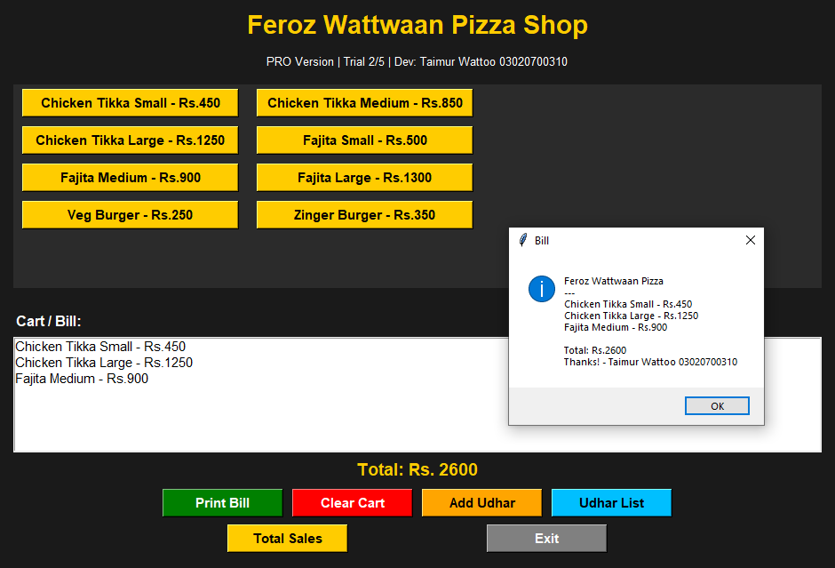
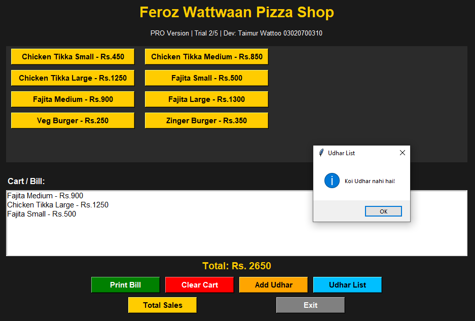

# 🍕 Feroz Wattwaan Pizza - POS Billing System
### Developed by: Taimur Wattoo | Python Developer | Lahore

## 📥 DOWNLOAD FREE DEMO (5 Free Trials - 12MB ZIP)
### 👉 [**CLICK HERE TO DOWNLOAD DEMO**](https://drive.google.com/file/d/1W7svSVRPJk1mNtyqsVqewymgBqzpDfxa/view?usp=sharing)

> ⚠️ After 5 trials, software auto-locks and shows: **Contact Taimur Wattoo - 03020700310**

---

## 📸 Live Screenshots

### 01 - Main Dashboard

### 03 - Print Bill Feature

### 04 - Daily Sales Report

### 05 - Udhar / Khata System

---

## ✨ Features
- ✅ Fast Pizza Order & Billing
- ✅ Print Bill / Receipt
- ✅ Daily Total Sales Report
- ✅ Udhar / Client Khata System
- ✅ 5 Free Trials + Auto Lock
- ✅ Clean Tkinter UI

## ⚙️ How To Use For Client
1. Download ZIP from link above
2. Extract ZIP
3. Run: `Feroz_Pizza_DEMO_5_Trail_BY_Taimur_Wattoo.exe`
4. Use 5 times free
5. On 6th time -> Lock -> Shows Your Contact

## 💻 Tech
Python, Tkinter, PyInstaller

## 📂 Code
`final_shop.py`

## 📞 For Full Version
**Taimur Wattoo - 03020700310**
**taimurwattoo36@gmail.com**
**GitHub: TaimurAlBot**

⭐ Star this repo!
